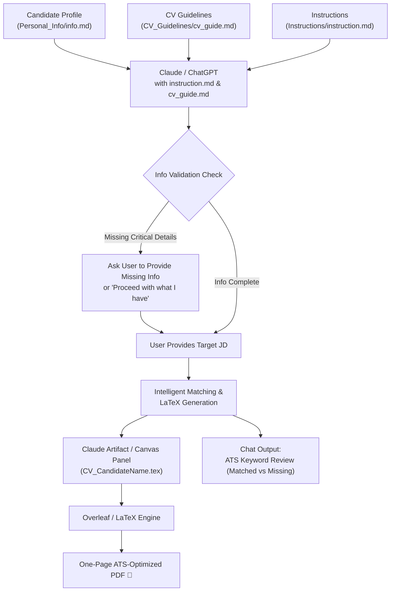

# AI-Powered ATS CV Generator System 🚀

An automated, intelligent, and ATS-optimized CV generation framework designed to work seamlessly with **Claude (Artifacts / Canvas)**, **ChatGPT**, **LaTeX**, and **Overleaf**.

This repository provides a modular, prompt-engineered system that tailors a **strictly one-page, ATS-compliant CV** for any given Job Description (JD) using the candidate's personal markdown profile as the **single source of truth** — eliminating AI hallucinations, formatting headaches, and multi-page overflow.

> **💡 Universal & Open-Source:** Any student, graduate, or professional can clone this repository, fill out the profile template, and generate tailor-made CVs for any tech job vacancy!

---

## 📌 Key Highlights

- **🛡️ Zero Hallucinations**: The AI is strictly constrained to facts from your candidate profile file (`info.md`). It will never invent fake metrics, inflated numbers, or non-existent credentials.
- **📄 Strictly One-Page A4 Rule**: Built-in LaTeX typography knobs and spacing constraints guarantee that the CV stays on exactly one page, filling neatly to the bottom margin.
- **🎯 Dynamic JD Alignment & ATS Title Matching**:
  - Directly matches the **exact Job Title** from the JD in the header subtitle and professional summary.
  - **Evidence-Based Summary**: Completely eliminates filler buzzwords (*"motivated"*, *"passionate"*, *"interested in"*) and leads with credentials, GPA, and the exact tech stack required by the employer.
  - Automatically identifies and picks the **4 best-matching projects** for the target role.
  - Prioritizes technical skills matching the JD requirements while retaining project tools.
  - Selects strictly the **2 strongest certifications** directly relevant to the vacancy (guarantees 1-page fit).
- **⚡ Claude Canvas / Artifact Integration**: The complete LaTeX code is delivered directly in Claude’s side Artifact panel (`CV_[CandidateName].tex`) for instant one-click copying — keeping the chat clean.
- **🔍 ATS Keyword Review**: Highlights keywords successfully matched in the CV and flags missing keywords from the JD so you can review and manually adjust if needed.
- **🧩 Reusable for Any Candidate**: Fully parameterized; works for any student, engineer, or professional across software, DevOps, cloud, data, and IT domains.

---

## 📂 Repository Structure

```text
Sachintha-CV-Profile/
├── README.md                      # Complete guide & documentation
│
├── Personal_Info/                 # Candidate data directory
│   ├── info_template.md           # Universal blank template for any candidate
│   └── info.md                    # Candidate profile (single source of truth for facts)
│
├── CV_Guidelines/                 # Layout and design specification
│   └── cv_guide.md                # Typography rules, spacing knobs, Overleaf guide,
│                                  # and base LaTeX template
│
└── Instructions/                  # AI agent orchestration
    └── instruction.md             # Master system instructions directing Claude & ChatGPT
                                   # on how to parse, validate, and build the CV
```

---

## 🛠️ How It Works (Step-by-Step)



---

## 🚀 Quick Start Guide (Build Your Own CV in 5 Minutes)

### Step 1: Clone or Fork this Repository
```bash
git clone https://github.com/sachilz/Sachintha-CV-Profile.git
cd Sachintha-CV-Profile
```

### Step 2: Fill Out Your Profile File
1. Open [`Personal_Info/info_template.md`](Personal_Info/info_template.md).
2. Copy it to [`Personal_Info/info.md`](Personal_Info/info.md) (or edit `info.md` directly).
3. Fill in your factual details:
   - Contact info & uniform social URLs (`linkedin.com/in/...`, `github.com/...`, `portfolio.com`)
   - Degree, GPA, relevant coursework, and secondary school
   - Technical skills grouped by category
   - At least 4 projects with title, GitHub link, 1-bullet description, and technologies
   - University clubs, student ambassadorships, technical writing, or experience
   - Verified course certifications & training
   - *(Optional)* References for a clean 2-column layout

### Step 3: Start a Chat with Claude (or ChatGPT)
Attach the following **3 files** in your initial prompt:
1. `Instructions/instruction.md`
2. `CV_Guidelines/cv_guide.md`
3. Your Profile file (`Personal_Info/info.md`)

> **Initial Prompt to AI:**
> *"Read the attached instructions, guidelines, and candidate profile. Please confirm once you are ready for the Job Description."*

### Step 4: Provide the Target Job Description (JD)
Once the AI acknowledges readiness:
1. Paste the target **Job Description (JD)** text or upload an image/screenshot of the job posting.
2. The AI will cross-reference your profile facts with the JD requirements and build your tailored CV.

### Step 5: Compile in Overleaf
1. Open [Overleaf](https://www.overleaf.com) and create a **Blank Project**.
2. Replace all contents with the generated LaTeX source code.
3. Click **Recompile** and download your ATS-ready, single-page PDF!

---

## 📐 Layout & Typography Standards

| Element | Standard / Value | Purpose |
|---|---|---|
| **Font** | Latin Modern (`lmodern`, 10pt base) | High-contrast, classic, ATS-recognized typography |
| **Page Length** | Strictly 1 A4 Page (Conditional 2 pages for dense refs) | Clean, focused, high-impact readability |
| **Margins** | Fixed Constant `\usepackage[margin=0.42in]{geometry}` | Strictly 0.42in on all 4 sides; permanent constant |
| **Candidate Name** | `{\LARGE\bfseries\MakeUppercase{...}}\\[1.5pt]` | Fixed 1.5pt vertical gap; prominent visual weight |
| **Section Headings** | `\titleformat{\section}{\bfseries\large\scshape}{}{0pt}{}` | 12pt Bold Small Caps; distinct visual hierarchy |
| **Section Spacing** | `\titlespacing*{\section}{0pt}{6.5pt plus 1.5pt minus 1pt}{2.2pt}` | Auto-calibrated glue spacing for perfect 1-page fit |
| **Colors** | `linkblue` (RGB: 0, 85, 190) & `techblue` (RGB: 55, 85, 150) | ATS-safe subtle visual distinction for links and tags |
| **Projects** | Exactly 4 projects, 1 factual bullet each | Defensible, realistic achievements (no inflated buzzwords) |
| **Project Gap** | Mandatory `\vspace{4.5pt plus 1pt minus 1pt}` or `\vspace{5pt}` | Clean visual separation between consecutive projects |
| **Summary** | Evidence-based, JD-tech-stack matched (3–4 lines) | Bans filler words (*"motivated"*, *"passionate"*, *"interested in"*) |

---

## 👤 Author & Maintainer

- **Sachintha Dilshan Madhushankha**
  - **Portfolio**: [sachilz.me](https://sachilz.me)
  - **LinkedIn**: [linkedin.com/in/sachilz](https://www.linkedin.com/in/sachilz)
  - **GitHub**: [@sachilz](https://github.com/sachilz)
  - **YouTube**: [@NextOpz](https://www.youtube.com/@NextOpz)

---

## 📄 License

This project is open-source and free to adapt for personal, academic, and career development purposes.
