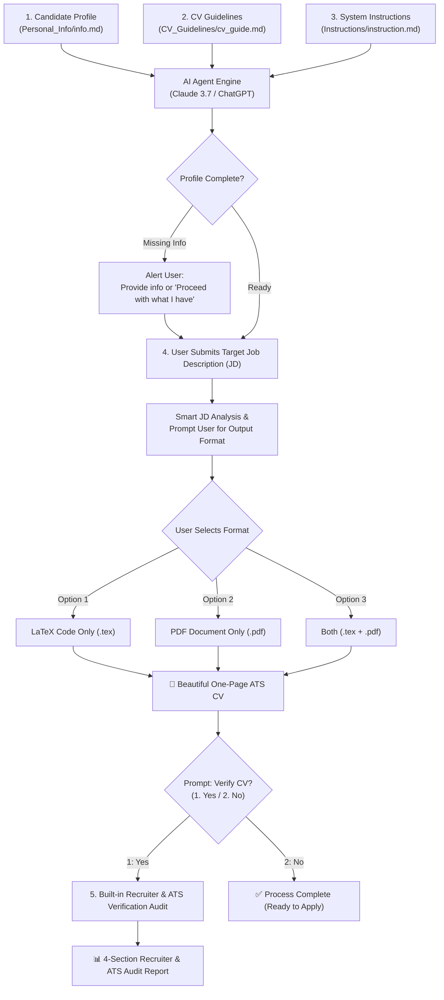

# 📄 AI-Powered ATS CV Generator Framework 🚀

[](https://www.overleaf.com)
[](https://claude.ai)
[](#-why-this-framework)
[](#-layout--typography-standards)
[](LICENSE)

An intelligent, production-ready CV generation framework engineered for **students, graduates, software engineers, and cloud/DevOps professionals**. 

This system bridges the gap between **raw career facts** and **ATS-tailored, single-page LaTeX CVs**. By combining strict prompt-engineered constraints with a tuned LaTeX layout, it eliminates the common pitfalls of AI-generated resumes: hallucinations, generic fluff, broken layouts, and multi-page overflow.

> **🌟 100% Universal & Open-Source:** Anyone can clone this repository, fill out the blank profile template, and generate custom, job-matched CVs in under 5 minutes!

---

## 📑 Table of Contents

- [The Problem It Solves](#-the-problem-it-solves)
- [Key Features](#-key-features)
- [Repository Architecture](#-repository-architecture)
- [How It Works (Pipeline)](#-how-it-works-pipeline)
- [Quick Start Guide (5 Steps)](#-quick-start-guide-5-steps)
- [Copy-Paste AI Prompts](#-copy-paste-ai-prompts)
- [Engine Standards & Typography](#-engine-standards--typography)
- [Privacy & Security](#-privacy--security)
- [Troubleshooting & FAQ](#-troubleshooting--faq)
- [Author & Maintainer](#-author--maintainer)

---

## 🎯 The Problem It Solves

| Common AI / Resume Pain Points | How This Framework Solves It |
|---|---|
| **AI Hallucinations & Fake Metrics** | Constrains AI strictly to your candidate profile file (`info.md`). Never invents metrics, tools, or fake job roles. |
| **Generic Filler Words** | Strictly bans clichés (*"motivated"*, *"passionate"*, *"interested in"*). Leads with verified GPA, credentials, and evidence. |
| **Multi-Page Overflow** | Tuned LaTeX geometry (`0.42in` margins, elastic glue spacing, 1-line tech tags) locks output strictly to **1 Page**. |
| **Unrealistic / Overclaimed Bullets** | Enforces defensible, technically sound project bullets (no inflated *"zero-downtime production"* claims for lab projects). |
| **Chat Clutter & Essays** | Completely eliminates verbose ATS reviews, essays, and checklists in the chat. Delivers only your clean CV files directly. |

---

## ✨ Key Features

- **🛡️ Single Source of Truth Architecture:** Your markdown profile (`info.md`) holds every fact about you. The AI acts only as an intelligent compiler and formatter, not an author.
- **📄 Strictly 1 A4 Page Fit:** Engineered with mathematical vertical space budgeting. Every element (header, 4 projects, skills, education, certifications, and experience) fits onto a single page without manual tweaking.
- **🎯 Dynamic Job Description (JD) Matching:**
  - Extracts the exact target Job Title from the posting and injects it into the subtitle and summary.
  - Automatically identifies and highlights the employer's tech stack.
  - Selects and orders the **top 4 projects by descending JD relevance** (Strongest direct matches first, followed by complementary engineering depth).
  - Selects strictly the **2 strongest certifications** relevant to the opening.
- **🎛️ 3 Output Formats (User Choice):**
  - **Option 1: LaTeX Code only** (for Overleaf / local compilation)
  - **Option 2: PDF only** (compiled, download-ready PDF)
  - **Option 3: Both** (LaTeX code + compiled PDF)
- **💼 100% JD-Matched Professional Summary:** Weaves verified credentials (GPA, student ambassadorship) and hands-on tooling with the employer's exact criteria (such as *problem-solving and analytical skills*, *eagerness to learn, adapt, and take initiative*) to maximize ATS keyword scores.
- **🎨 Visual Hierarchy & Clean Typography:** Uses Latin Modern typography, `\large` bold small-caps section headings, distinct project separations (`\vspace{5pt}`), and uniform domain link styling.
- **🔒 Privacy First:** Integrated `.gitignore` ensures your personal contact information (phone number, email, references) never gets accidentally committed to public repositories.

---

## 📂 Repository Architecture

```text
Personal_CV_Generator/
│
├── README.md                      # Comprehensive user guide and project documentation
├── .gitignore                     # Protects private candidate data from git commits
│
├── Personal_Info/                 # Candidate data directory
│   ├── info_template.md           # Universal blank template ready for ANY candidate
│   └── info.md                    # (Local/Private) Your filled personal profile file
│
├── CV_Guidelines/                 # Design & typography specifications
│   └── cv_guide.md                # Base LaTeX template, spacing knobs, and rules
│
└── Instructions/                  # Master CV generator & built-in audit instructions
    └── instruction.md             # Master system prompt for Claude (Artifacts) & ChatGPT
```

---

## 🔄 How It Works (Pipeline)



---

## 🚀 Quick Start Guide (5 Steps)

### Step 1: Clone or Fork this Repository
```bash
git clone https://github.com/sachilz/Personal_CV_Generator.git
cd Personal_CV_Generator
```

### Step 2: Create Your Profile File
1. Open [`Personal_Info/info_template.md`](Personal_Info/info_template.md).
2. Copy it to create your private profile file:
   ```bash
   cp Personal_Info/info_template.md Personal_Info/info.md
   ```
3. Fill out your details:
   - Contact info & uniform links (`linkedin.com/in/...`, `github.com/...`, `portfolio.com`)
   - Degree, GPA, relevant coursework, and high school
   - Technical skills grouped by categories
   - At least 4 projects (1 factual bullet point each)
   - Extracurriculars, clubs, content creation, or experience roles
   - Verified certifications (course certificates)

> *Note: `Personal_Info/info.md` is pre-configured in `.gitignore`, so your personal data remains strictly local and private.*

### Step 3: Run with Claude or ChatGPT
1. Open [Claude](https://claude.ai) (Recommended for Canvas/Artifacts) or [ChatGPT](https://chatgpt.com).
2. Attach the **3 core files**:
   - `Instructions/instruction.md`
   - `CV_Guidelines/cv_guide.md`
   - `Personal_Info/info.md`
3. Send the **Initial Prompt** (see prompt template below).
4. When the AI confirms readiness, paste your target **Job Description (JD)**.

### Step 4: Choose Your Output Format & Download
The AI will ask for your preferred output format:
- **Option 1: LaTeX Code only** (for Overleaf compilation)
- **Option 2: PDF only** (download-ready PDF)
- **Option 3: Both** (LaTeX code + compiled PDF)

Reply with **1**, **2**, or **3**, and the AI will deliver your CV directly without chat clutter or review essays!

### Step 5: (Optional) Verify Your CV (1: Yes / 2: No)
Once your CV is delivered, the AI will ask:
> *"Would you like me to verify (check) your CV with a Hyper-Critical Recruiter & ATS Verification Audit against your target Job Description? (1. Yes / 2. No)"*

- Reply **1** or **Yes** to receive a ruthless **4-section audit report**:
  - **ATS Score & Compatibility (1–100 Rating & Missing Keywords)**
  - **Strengths & Weaknesses (Top 3 of each from Hiring Manager scan)**
  - **Bullet Point Optimization (Duty-based vs Achievement-based Before/After rewrites)**
  - **Red Flags & Recruiter Screening Check (Pass / Warning / Rejection)**
- Reply **2** or **No** to finish immediately!

---

## 💬 Copy-Paste AI Prompts

### Message 1: System Initialization
```text
I have attached three files:
1. instruction.md (Execution rules, workflow, and built-in verification audit)
2. cv_guide.md (Layout, LaTeX template, and typography constraints)
3. info.md (My verified personal profile data)

Please read all three files thoroughly. Verify my profile against the required sections. Once verified, please confirm that you are ready for my target Job Description (JD). Do not generate any LaTeX code or PDF yet.
```

### Message 2: Submitting the Job Description
```text
Here is the target Job Description (JD) I am applying for:

[PASTE FULL JOB DESCRIPTION TEXT OR DETAILS HERE]

Please analyze this JD and match my profile facts against its requirements. Ask me for my preferred output format (1: LaTeX Code only, 2: PDF only, 3: Both) before generating the CV.
Remember:
- Include the exact target Job Title as subtitle under candidate name.
- Dynamically adapt the Professional Summary to match the JD's tech stack and criteria (e.g. problem-solving, analytical skills, eagerness to learn).
- Use proper LaTeX environments (\hfill for dates, \begin{itemize}\item for all lists; NO raw hyphens or pipes).
- Strictly 1 A4 page (all 7 sections on Page 1, fill page vertically with no large blank bottom gap, omit references unless requested, exact LaTeX preamble with section underline rules).
```

### Message 3: (Optional) Verification Audit Response
```text
1
```
*(Reply **1** or **Yes** when the AI asks if you want your CV verified, or **2** / **No** to finish).*

---

## 📐 Engine Standards & Typography

The LaTeX engine is calibrated to maximize readability, maintain 100% equal margins, and guarantee a 1-page fit:

| Element | Exact Standard | Reason / Impact |
|---|---|---|
| **Preamble Geometry** | `\usepackage[margin=0.42in]{geometry}` | Strictly constant 0.42in margins on all 4 sides; provides optimal vertical real estate. |
| **Candidate Name** | `{\LARGE\bfseries\MakeUppercase{...}}\\[1.5pt]` | Prominent visual anchor; locked 1.5pt spacing prevents awkward vertical gaps. |
| **Section Headings** | `\titleformat{\section}{\bfseries\large\scshape}{}{0pt}{}` | 12pt Bold Small Caps with a clean horizontal rule (`\rule{\linewidth}{0.5pt}`). |
| **Section Spacing** | `\titlespacing*{\section}{0pt}{6.5pt plus 1.5pt minus 1pt}{2.2pt}` | Auto-calibrated elastic glue spacing; LaTeX compresses or stretches dynamically. |
| **Project Separators** | Mandatory `\vspace{4.5pt plus 1pt minus 1pt}` | Enforces clean breathing space between consecutive projects; never removed. |
| **Technologies Lines** | Strictly 1 line per project (e.g. 6 to 8 tags) | Styled with `\textcolor{techblue}{...}`; never wraps to a 2nd line. |
| **Experience Heading** | `\section{Community \& Content Experience}` | Transparent and honest for undergraduates; builds recruiter trust. |
| **Bullet Points** | `itemsep=1.2pt plus 0.4pt minus 0.4pt,topsep=1.5pt` | Compact, highly readable list spacing. |

---

## 🔒 Privacy & Security

Your resume contains sensitive personal data (phone numbers, email addresses, referee contact details). 

This repository includes a pre-configured `.gitignore` that prevents your personal profile files from being tracked:
- `Personal_Info/info.md`
- `Personal_Info/*-pi.md`
- `Personal_Info/*.private.md`

Only the blank template ([`Personal_Info/info_template.md`](Personal_Info/info_template.md)) and system instruction files remain in version control. You can safely fork and contribute to this repository without risking privacy leaks.

---

## ❓ Troubleshooting & FAQ

### Q1: What if the generated CV spills over onto a 2nd page?
The spacing engine is designed so that a standard profile with 4 projects, 2 certificates, skills, education, and experience fits on 1 page. If an overflow occurs:
1. **Check the Technologies lines:** Ensure each project's `Technologies:` line hasn't wrapped onto a 2nd line.
2. **Summary length:** Ensure the Professional Summary is strictly 3 to 4 lines.
3. **Certifications count:** Keep strictly to the 2 most relevant certificates.
4. **Project count:** Keep strictly to 4 projects.

### Q2: Can I include References?
Yes. If you explicitly request references in your prompt (e.g. *"Include references"*), the AI formats them into a clean 2-column `minipage` layout. By default, references are omitted to ensure every CV fits strictly on 1 page. If references are included and cause an overflow, the AI cleanly formats them without breaking the visual structure.

### Q3: Why LaTeX instead of Word or Canva?
- **ATS Parsers Love LaTeX:** LaTeX produces pure, searchable, standard font-encoded text without weird hidden tables or columns that trip up ATS scanners.
- **Mathematical Precision:** Spacing and layout are deterministic — unlike Word, which shifts margins and breaks pagination unpredictably.

---

## 👤 Author & Maintainer

Created and maintained with ❤️ by:

**Sachintha Dilshan Madhushankha**  
*IT Undergraduate | Microsoft Learn Student Ambassador | DevOps & Cloud Enthusiast*

- 🌐 **Portfolio**: [sachilz.me](https://sachilz.me)
- 💼 **LinkedIn**: [linkedin.com/in/sachilz](https://www.linkedin.com/in/sachilz)
- 🐙 **GitHub**: [@sachilz](https://github.com/sachilz)
- 📺 **YouTube**: [@NextOpz](https://www.youtube.com/@NextOpz)
- ✍️ **Medium**: [@sachilz](https://medium.com/@sachilz)

---

## 📄 License

This framework is licensed under the [MIT License](LICENSE). You are free to fork, customize, share, and use this repository for your career and academic journey.
